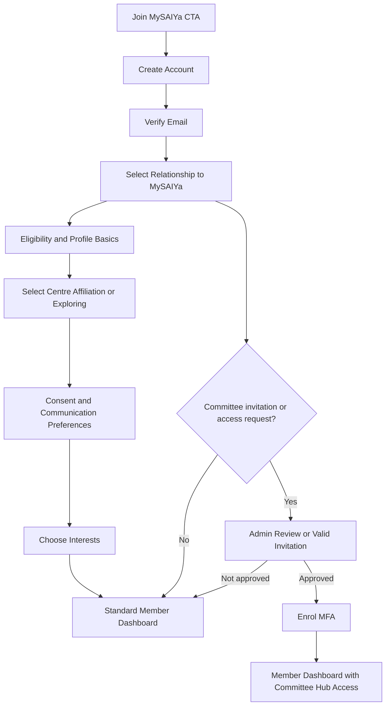

# MySAIYa Digital Hub — User Authentication Flow

## Implementation Principle

A visitor may identify their relationship to MySAIYa during onboarding, but must never assign a privileged role to themselves. Committee, moderator, and administrator roles require an invitation or an explicit approval by an authorised administrator.

## Public Entry Points

| Entry point | Route | Outcome |
|---|---|---|
| Join MySAIYa header CTA | `/signup` | Google-first account creation |
| Members-only learning prompt | `/signin?redirect=...` | Returns the user to the requested resource after authentication |
| Existing member sign-in | `/signin` | Opens the appropriate dashboard after authentication |
| Continue with Google | `/signin` or `/signup` | Federated sign-in; a first-time Google account is sent to `/setup` to finish onboarding |
| Continue as Guest | `/signin` or `/signup` | Browses the public site with no account and no Firestore record |
| Profile setup wizard | `/setup` | Collects onboarding steps 3–7; sets `onboardingComplete` |
| Committee invitation link | `/account/sign-up?invite=...` | Email/password registration; the invitation is validated server-side |
| Email and password | `/account/sign-in`, `/account/sign-up` | Kept for members who registered before Google sign-in, and for invitations |

Hash-style links (`#/signin`, `#/signup`, `#/setup`) are rewritten to the
equivalent path by `src/components/HashRouteBridge.js`, so older printed and
linked material keeps working.

### Guest mode

A guest is deliberately **not** a Firebase user. There is no anonymous auth
account and no `users/{uid}` document — the whole session is a `mysaiya.guest`
flag in the browser's localStorage (`src/lib/auth/guest.ts`). That is what makes
the two warnings in the guest dialog literally true: nothing is saved, and the
visit is not attributed to any Centre's count. Signing in clears the flag; the
two states are mutually exclusive.

## Recommended Signup Flow



## Step-by-Step Specification

The Google path collapses steps 1–2 (Google attests the email) and presents
steps 3–7 on the single `/setup` screen. The compulsory fields there are name,
gender (chosen with the avatar), date of birth, state, and Centre — with
"Not Affiliated to SSIOM Sai Centre" always available. Nickname, SSIOM role,
favourite quote or bhajan link, and SSE/SSEHV graduation year are optional.

| Step | Route or state | User action | System action | Outcome |
|---|---|---|---|---|
| 1 | `/signup` (or `/account/sign-up`) | Continue with Google, or enter name, email, password | Validate input, apply rate limits, create the account | Google accounts arrive verified; email accounts get a verification message |
| 2 | `/account/verify-email` | Open verification link | Verify token and email ownership | Continue onboarding |
| 3 | Onboarding: relationship | Select: MySAIYa Young Adult, prospective young adult, SSIOM volunteer/supporter, or invited committee member | Store relationship as profile metadata, not as privileged authorization | Standard account remains least-privileged |
| 4 | Onboarding: eligibility | Confirm age eligibility for young-adult participation and provide only the minimum necessary details | Apply eligibility rules; do not collect national ID numbers | Appropriate content and programmes shown |
| 5 | Onboarding: centre | Select a centre, Bhajan Unit, nearest cluster, or “I am exploring” | Store optional centre affiliation | Personalised dashboard recommendations |
| 6 | Onboarding: consent | Review privacy notice; accept account terms; choose optional preferences separately | Create versioned consent records with timestamps | Consent audit trail created |
| 7 | Onboarding: interests | Select service, spiritual, learning, leadership, bhajan, or community interests | Store optional preferences | Personalised dashboard |
| 8 | `/dashboard` | Enter member area | Enforce session and role checks | Member dashboard |
| 9 | Privileged access | Open approved invitation or submit access request | Validate invitation or queue admin approval | No automatic role escalation |
| 10 | `/dashboard/security` | Enrol multi-factor authentication | Require MFA before privileged access | Committee Hub available only after MFA |

## Role Model

Replaced the `member / contributor / moderator / committee / admin` model on
2026-08-12. Legacy claim values are mapped forward (`admin` and `committee` →
Central Leader, `moderator` → Centre Leader, `contributor` → Formal Member) in
both `src/lib/auth/roles.ts` and `firestore.rules`, so no existing account is
locked out while tokens refresh.

```
Guest (anonymous, no DB record)
  ↓
Member (any Google account, auto-approved, Active)
  ↓
Formal Member (verification flow, approval delegated to Regional Leaders — §5)
  ↓
Committee (@mysaiya.com domain match — Centre Leader is automatic, §0.2)
  ├── Centre Leader     — scoped to ONE centre  — AUTOMATIC on domain match
  ├── Regional Leader   — scoped to ONE region  — verified by a Central Leader
  └── Central Leader    — national scope        — verified by a Super Admin

Super Admin (named seats, additive on top of the role above)
  ├── National MySAIYa Coordinator
  ├── MySAIYa Secretary
  └── SSIOM Secretary
```

| Role | Data scope | Permissions |
|---|---|---|
| Member | Own record | Content, quizzes, comments; earns certificates on completion |
| Formal Member | Own record | Member access + courses requiring formal status |
| Centre Leader | Own centre (`centreId`) | Attendance, reports, calendar, moderation, photos for their centre. **Automatic on domain match — no approval** |
| Regional Leader | All centres in own region (`regionId`) | Centre Leader powers across the region + regional events/announcements + **Formal Member approval for their region**. Verified by a Central Leader |
| Central Leader | National | Everything above nationally + blog, learning modules, leaderboard, national events, user management, override of any Formal Member decision. Verified by a Super Admin |
| Super Admin (seat) | National + system | Everything Central Leader can do + manage admins' roles, assign seats, site config, audit log |

**Super Admin is a seat, not a tier you can reach.** It is additive: a holder
keeps `role: 'central_leader'` for operational permissions and gains system-level
permissions from the seat. Seats live on `@ssiomya.com` — deliberately outside
the auto-activation domain — so they are always set up on purpose. The first
holders are set with `npm run set-seat`; after that only an existing Super Admin
can reassign one, at `/committee/admins`.

**PDPA:** full NRIC/passport numbers stay out of this database entirely.
Everyone in the approval chain, Regional Leaders included, works from
`id_last_4_chars`. Only a Super Admin escalation would consult the external
secured record, and that is a manual off-platform lookup the app never exposes.

## Sign-in and Recovery Rules

- Use individual accounts; never use a shared committee password.
- Require verified email before dashboard access.
- Require MFA for committee members, moderators, and administrators.
- Apply server-side authorization checks to every protected request.
- Return a friendly `/account/access-denied` page when an authenticated user lacks permission.
- Use secure, expiring password-reset links and avoid revealing whether an email address exists.
- Store session tokens securely and support session revocation from `/dashboard/security`.
- Record privileged access changes in `/committee/audit-log`.

## §0.2 Domain Auto-Activation

A verified Google sign-in on the `@mysaiya.com` Workspace domain becomes an
**active Centre Leader immediately** — no pending state, no approval click, no
holding page. Domain plus successful Google auth is treated as sufficient proof
of legitimacy for the baseline committee tier.

This is the only place in the system where a privileged role is granted without
a human approver, so the proof is deliberately narrow. `isAutoActivationEligible()`
(`src/lib/auth/claims.ts`) requires **all three**:

1. `firebase.sign_in_provider === 'google.com'` — the email/password path can
   never qualify. Anyone can *register* an account claiming an `@mysaiya.com`
   address; only Google can attest control of a Workspace account.
2. `email_verified === true`.
3. A domain match, preferring Google Workspace's `hd` (hosted domain) claim over
   parsing the email string. When `hd` is present it must match exactly.

Activation only ever grants the **baseline**. It sets `centre_leader`, never a
higher tier, never a Super Admin seat, and never reinstates a suspended account.
Regional and Central remain verification-gated (§3).

Centre selection at `/committee/choose-centre` is **scoping, not approval** — the
member already has working access when they arrive there, and the region is
derived from the centre rather than chosen, so nobody can file themselves under
a region their centre is not in.

## §3 Upgrade Requests and the Verification Chain

A tiered chain, not "any higher-up approves anyone":

| Requested | Verified by | Queue |
|---|---|---|
| Centre Leader | — | Never requested; automatic (§0.2) |
| Regional Leader | A Central Leader | `/committee/pending-review` |
| Central Leader | A **Super Admin only** | `/committee/pending-review` |

Requesting is a separate, later action at `/committee/request-upgrade`, never
part of first sign-in. A pending request **never** revokes or pauses the
requester's existing Centre Leader access — `committeeStatus` becomes
`pending_regional` / `pending_central` while the role claim is untouched. The
Pending Review queue therefore only ever contains Regional and Central requests.

Denial returns the requester to plain active Centre Leader; it never removes
access they already had.

## Federated Sign-in (Google)

Google is offered alongside email/password on both `/account/sign-in` and
`/account/sign-up`. It changes who proves identity — never what the account is allowed
to do: a Google account arrives as `member` like any other, and the relationship a
visitor selects during onboarding remains profile metadata.

| Case | Detection | Destination |
|---|---|---|
| Returning Google member | `users/{uid}` exists, `onboardingComplete` | `/dashboard` (or the `redirect` target) |
| First Google sign-in | no `users/{uid}` document | `/account/sign-up` — the registration wizard runs against the authenticated account, collecting relationship, centre, interests, and consent; no password fields |
| Onboarding abandoned midway | `users/{uid}` missing or `onboardingComplete === false` | Back to `/account/sign-up` on the next visit |

Google accounts arrive with a verified email, so they skip step 2. Email/password
accounts still must verify before `/dashboard` opens.

## Account Status and Deactivation

Status is derived from the profile (see `docs/09-database-schema.md` §2.2) and checked
server-side on every guarded request:

- **Suspension** is a moderation action by an admin (`suspended: true`), reversible, and
  blocks every guarded route while leaving the account signed-in-able.
- **Deactivation** is account closure. Self-service from `/dashboard/privacy`, or by an
  admin. It disables the Firebase Auth user, stamps `deactivatedAt`, revokes all refresh
  tokens, and writes an audit-log entry. The profile is retained — this is closure, not
  erasure; deletion requests are handled separately via `/privacy/data-request`.

## Versioned Privacy Acceptance

`consent.privacyNoticeVersion` records the notice version a member accepted. When the
current version moves ahead of the stored one, `/dashboard/*` redirects to
`/dashboard/privacy` until the member accepts the new notice. Acceptance is re-stamped
with a fresh `termsAcceptedAt`, preserving the consent audit trail required by step 6.
Optional preferences (newsletter, event comms) are always separate opt-ins and are never
bundled into that acceptance.

## Rate Limiting and Brute-force Protection

Firebase Authentication remains the primary defence against password guessing — sign-in
happens directly between the browser and Firebase, so our server never sees a failed
password and cannot count them authoritatively. Two layers are added on top:

1. **Server-session throttle** (enforced) — `POST /api/auth/session` is rate limited per
   IP and per account. Guarded routes require a session cookie, so an attacker who
   guesses a password still cannot obtain a server session while throttled.
2. **Reported-attempt lockout** (advisory) — the sign-in page reports failures to
   `POST /api/auth/attempt`, which counts them per account and returns a lockout. This
   adds friction and gives admins visibility; because a hostile client can simply not
   report, it is deliberately not the only control.

Password-recovery requests are throttled per IP on the same mechanism, and continue to
return an identical response whether or not the address exists.

## Implementation Status

Built in `10_Source_Code/webapp/apps/web`. See `docs/08-admin-system.md` §2 for the
enforcement layers.

| Area | Where | State |
|---|---|---|
| Sign-up, sign-in, email verification, password reset | `src/app/account/*` | Built (Firebase Auth, client SDK) |
| Google sign-in | `src/components/auth/GoogleSignInButton.tsx`, on sign-in + sign-up | Built — **needs the Google provider enabled in the Firebase console** |
| First-login flow | `needsRegistrationWizard()` → `/account/sign-up` in completion mode | Built |
| Server session | `POST`/`DELETE /api/auth/session` → HttpOnly `__session` cookie | Built |
| Permission model (roles, route rules, decisions) | `src/lib/auth/permissions.ts` | Built — single source of truth |
| Permission middleware (fast redirects, unverified cookie) | `src/middleware.ts` | Built |
| Server route locks (verified cookie, the real gate) | `src/lib/auth/session.ts` + protected layouts | Built |
| API guards | `guardApi()` — cookie or bearer token | Built |
| Role detection | `role` claim → `Principal.role`; `useAuth()` client-side | Built |
| Account status | `src/lib/auth/accountStatus.ts` (derived, never stored) | Built |
| Privacy acceptance (versioned) | Gate in `permissions.ts` → `/dashboard/privacy` | Built |
| Session management + login history | `/dashboard/security`, `users/{uid}/loginHistory` | Built |
| Token refresh | `onIdTokenChanged` sync + 50-min tick + on tab focus; 401 ends the session | Built |
| Account recovery | `/account/forgot-password`, `/account/reset-password`, throttled | Built |
| User deactivation (self-closure) | `POST /api/account/deactivate`, `/dashboard/privacy` | Built |
| Rate limiting / brute-force | `src/lib/auth/rateLimit.ts` + `authThrottle` | Built — see the section above for what is enforced vs advisory |
| MFA requirement for privileged roles | `MYSAIYA_REQUIRE_COMMITTEE_MFA` env flag | Rule built, **off by default** |
| MFA enrolment UI | `/dashboard/security` | **Not built** — the reason the flag defaults off |
| Admin-initiated deactivation UI | `/committee/members` | Not built — the data model supports it (`deactivatedBy`) |
| Onboarding resume | `/account/sign-up` in completion mode | Built — the wizard is a single step, so "resume" means re-running it |

The session is recognised as carrying a second factor when Firebase issues it after an
MFA challenge (the `firebase.sign_in_second_factor` claim). Enabling the flag before
enrolment exists would lock every committee member out of the Hub.

## Dashboard Routing

| User state | Post-login destination |
|---|---|
| Onboarding incomplete | Resume onboarding |
| Standard member | `/dashboard` |
| Contributor or moderator | `/dashboard`, with relevant shortcuts |
| Committee member with MFA complete | `/dashboard`, with visible Committee Hub link |
| Privileged user without MFA enrolment | `/dashboard/security` |
| Suspended or unapproved account | `/account/access-denied` |
