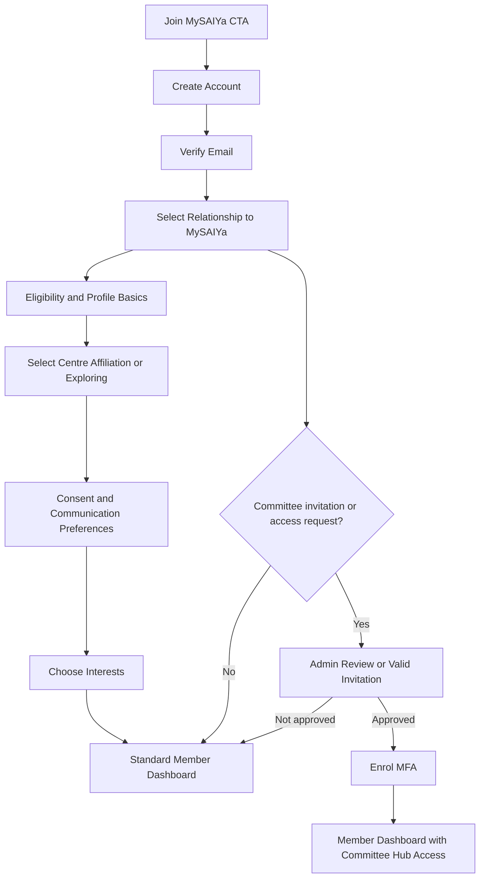

# MySAIYa Digital Hub — User Authentication Flow

## Implementation Principle

A visitor may identify their relationship to MySAIYa during onboarding, but must never assign a privileged role to themselves. Committee, moderator, and administrator roles require an invitation or an explicit approval by an authorised administrator.

## Public Entry Points

| Entry point | Route | Outcome |
|---|---|---|
| Join MySAIYa header CTA | `/account/sign-up` | Starts account creation |
| Members-only learning prompt | `/account/sign-in?redirect=...` | Returns the user to the requested resource after authentication |
| Committee invitation link | `/account/sign-up?invite=...` | Starts standard registration and validates the invitation server-side |
| Existing member sign-in | `/account/sign-in` | Opens the appropriate dashboard after authentication |

## Recommended Signup Flow

## Step-by-Step Specification

| Step | Route or state | User action | System action | Outcome |
|---|---|---|---|---|
| 1 | `/account/sign-up` | Enter name, email, password | Validate input, apply rate limits, create unverified account | Email-verification message sent |
| 2 | `/account/verify-email` | Open verification link | Verify token and email ownership | Continue onboarding |
| 3 | Onboarding: relationship | Select: MySAIYa Young Adult, prospective young adult, SSIOM volunteer/supporter, or invited committee member | Store relationship as profile metadata, not as privileged authorization | Standard account remains least-privileged |
| 4 | Onboarding: eligibility | Confirm age eligibility for young-adult participation and provide only the minimum necessary details | Apply eligibility rules; do not collect national ID numbers | Appropriate content and programmes shown |
| 5 | Onboarding: centre | Select a centre, Bhajan Unit, nearest cluster, or “I am exploring” | Store optional centre affiliation | Personalised dashboard recommendations |
| 6 | Onboarding: consent | Review privacy notice; accept account terms; choose optional preferences separately | Create versioned consent records with timestamps | Consent audit trail created |
| 7 | Onboarding: interests | Select service, spiritual, learning, leadership, bhajan, or community interests | Store optional preferences | Personalised dashboard |
| 8 | `/dashboard` | Enter member area | Enforce session and role checks | Member dashboard |
| 9 | Privileged access | Open approved invitation or submit access request | Validate invitation or queue admin approval | No automatic role escalation |
| 10 | `/dashboard/security` | Enrol multi-factor authentication | Require MFA before privileged access | Committee Hub available only after MFA |

## Role Model

| System role | Self-selectable? | Intended access |
|---|---|---|
| Visitor | Not applicable | Public pages |
| Registered member | Default after onboarding | Dashboard, learning, event history, submissions |
| Contributor | Request or administrator assignment | Submit draft articles and write-ups |
| Moderator | Administrator assignment only | Moderate forums and submitted content |
| Committee member | Invitation or approval only | Approved sections of Committee Hub |
| Administrator | Assignment by existing administrator only | Role administration, configuration, and audit logs |

## Sign-in and Recovery Rules

- Use individual accounts; never use a shared committee password.
- Require verified email before dashboard access.
- Require MFA for committee members, moderators, and administrators.
- Apply server-side authorization checks to every protected request.
- Return a friendly `/account/access-denied` page when an authenticated user lacks permission.
- Use secure, expiring password-reset links and avoid revealing whether an email address exists.
- Store session tokens securely and support session revocation from `/dashboard/security`.
- Record privileged access changes in `/committee/audit-log`.

## Dashboard Routing

| User state | Post-login destination |
|---|---|
| Onboarding incomplete | Resume onboarding |
| Standard member | `/dashboard` |
| Contributor or moderator | `/dashboard`, with relevant shortcuts |
| Committee member with MFA complete | `/dashboard`, with visible Committee Hub link |
| Privileged user without MFA enrolment | `/dashboard/security` |
| Suspended or unapproved account | `/account/access-denied` |
