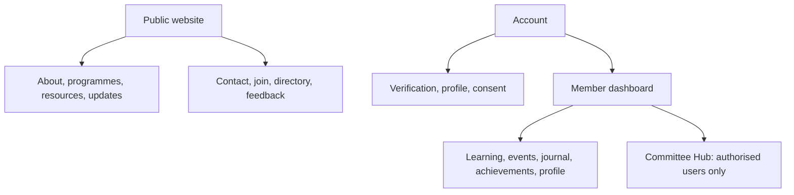

# Information architecture

The public site must work without an account. The dashboard is personal; Committee Hub is a separate privileged surface. The route register/sitemap governs labels and URLs.
