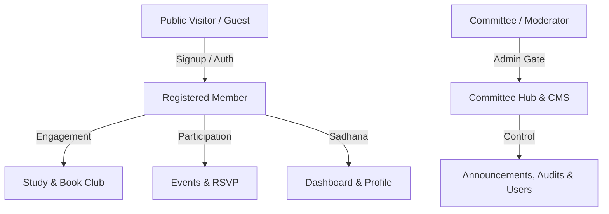

# MySAIYa Digital Hub: Web Audit and Quality Control System
**Document ID:** SMS-QA-12  
**Status:** Pre-Production Review / Prototype QA  
**Version:** 1.0 (2026)  
**Target Audience:** Non-technical Reviewers, Web Developers, Committee Members, Content Editors, Event Managers, Accessibility & Privacy Auditors.

---

## 1. Introduction & Overview

The **MySAIYa Digital Hub Quality Control System** ensures that the portal delivers a secure, premium, accessible, and seamless experience for all Malaysian Sai Young Adults (YA) and visitors. This document serves as the master checklist, journey map, and functional audit manual for verification both during the prototype phase and prior to production release.



> [!IMPORTANT]
> **Staging vs. Production Note:**  
> This system distinguishes between **Prototype/Staging validation** (which may use temporary storage like `localStorage` and `sessionStorage`) and **Production Readiness** (requiring full Firebase Authentication, Firestore databases, and server-side rules).

---

## 2. Testing Roles

Testers must audit the web portal using the persona matches below:

| Tester Type | Focus Area | Example Journeys |
| :--- | :--- | :--- |
| **Public Visitor Tester** | Public reach, first impressions | Homepage, header navigation, public events list, resource cards, contact forms. |
| **Young Adult Member Tester** | Active member engagement | Registration wizard, login, member dashboard, Book Club reading progress, quizzes, submissions. |
| **Committee Tester** | Back-office management, moderation | Committee Hub (`/committee`), role-request reviews, audit logs, editing weeks, updates banner manager. |
| **Mobile Tester** | Responsiveness and touch targets | iOS (Safari), Android (Chrome), tablet viewport layout, input focus behavior, virtual keyboard overlays. |
| **Accessibility Tester** | Inclusivity and standard compliance | Keyboard-only navigation (Tab/Enter), screen reader (VoiceOver/NVDA) accessibility, color contrast. |
| **Content Reviewer** | Editorial guidelines and tone | Text accuracy, spelling, tone of voice, link integrity, image descriptive captions. |
| **Privacy Reviewer** | Regulatory compliance | Verification of cookies, Privacy Notice consent, separate media releases, user profile data isolation. |
| **SEO Reviewer** | Search visibility and indexation | XML sitemap, robot configuration, canonical tags, Open Graph meta-tags, Structured Data (JSON-LD). |

---

## 3. Test Environment Setup & Checklist

Confirm the following prerequisites before initiating an audit cycle:

- [ ] **Test URL Access:** Staging domain or local development server (`http://localhost:3000`) is running.
- [ ] **Devices Ready:** One desktop browser (Chrome/Safari/Firefox/Edge) and at least one mobile device (iPhone and/or Android).
- [ ] **Test Accounts Provisioned:**
  - [ ] Visitor (Unauthenticated)
  - [ ] Standard Member Account (e.g. `member@test.mysaiya.my`)
  - [ ] Committee/Admin Account (e.g. `committee@test.mysaiya.my`)
- [ ] **Mock Content Configured:**
  - [ ] At least one upcoming event is active.
  - [ ] At least one Book Club week is in "Published" state and one in "Drafting".
  - [ ] A functioning contact form test email routing configuration is set.
- [ ] **Clean Environment:** Browser cache cleared or testing in an Incognito/Private window (Recommended).

---

## 4. Audit Severity Levels

When recording issues in the Issue Log, classify them using these criteria:

| Severity | Definition | Examples |
| :--- | :--- | :--- |
| <span style="color:red">**Critical**</span> | Blocks launch, exposes sensitive data, or crashes major infrastructure. | `/committee` or member profiles accessible without logging in; database rules allow public writes to all records. |
| <span style="color:orange">**High**</span> | Major user journey broken with no logical workaround. | Members unable to submit event registrations; Book Club quiz fails to unlock despite 100% reading progress. |
| <span style="color:yellow">**Medium**</span> | Functional issue but a clear workaround exists. | Global search layout broken on small screens; Tamil/Chinese fonts rendering incorrectly on specific components. |
| <span style="color:blue">**Low**</span> | Visual polishing, spacing, or minor editorial bugs. | Spacing inconsistency on footer links; missing alt text on a decorative background image. |
| <span style="color:green">**Enhancement**</span> | Polish, suggestions, or potential features for future updates. | Adding custom transition animations to the homepage quote slider; adding user profile avatars. |

---

## 5. Core User Journey Audits

### 5.1 Homepage Hero and CTA Buttons
**Location:** `/` (Hero Section)

1. **Steps to Test:**
   * Open the homepage (`/`).
   * Verify the MySAIYa logo and title load cleanly.
   * Verify main Call-to-Action (CTA) buttons: *Join MySAIYa*, *Explore Programmes*, *Upcoming Events*.
   * Click/Tap each CTA button and track destinations.
2. **Expected Behavior:**
   * Text is highly readable over background gradients or images.
   * Mobile version stacks content cleanly without text clipping.
   * No Layout Shift (CLS) during hero load.
3. **Acceptance Criteria:**
   * [ ] High contrast text readability on all resolutions.
   * [ ] CTA buttons navigate to `/connect/join/membership`, `/resources/blog`, and `/updates/events`.
   * [ ] Smooth font loading without layout shifts.

---

### 5.2 Announcement / Updates Banner
**Location:** Top of homepage or directly below the main navigation header.

1. **Steps to Test:**
   * Navigate to `/`.
   * Check for the latest announcement banner.
   * Hover over the banner (desktop) or tap it (mobile).
   * Click/tap the banner.
2. **Expected Behavior:**
   * The banner is noticeable but not visually intrusive.
   * Clicking navigates directly to the specified event/announcement.
   * Hides gracefully if disabled or if no active updates exist.
3. **Acceptance Criteria:**
   * [ ] Hover states and pointer cues function on desktop.
   * [ ] Navigation target matches announcement payload.
   * [ ] Text meets color contrast requirements.

---

## 6. Header and Navigation Audit

### 6.1 Desktop Navigation Menu
**Location:** Header (Viewports > 1024px)

1. **Steps to Test:**
   * Open the homepage on a desktop screen.
   * Verify items: *MySAIYa 101*, *In Action*, *Resources*, *Connect*, *FAQ*.
   * Hover/click dropdown items and click through each path.
   * Perform a keyboard tab-through of the menu.
2. **Expected Behavior:**
   * Hover/focus states activate instantly with a clear visual indicator.
   * Sub-menus render within viewport limits.
   * Active pages are visually styled (e.g., gold accent or underline).
3. **Acceptance Criteria:**
   * [ ] All navigation links point to valid routes.
   * [ ] Dropdowns open on hover, click, and keyboard focus.
   * [ ] Keyboard navigation (Tab) handles the focus ring correctly.

---

### 6.2 Mobile Navigation Drawer
**Location:** Hamburger Menu (Viewports < 1024px)

1. **Steps to Test:**
   * Open the website on a mobile device or responsive simulator.
   * Tap the hamburger menu icon.
   * Expand accordions inside the drawer.
   * Sign in and reopen the drawer to inspect changes.
2. **Expected Behavior:**
   * Drawer slides in smoothly without lag.
   * Accordions expand and collapse cleanly without text clipping.
   * User sees specific dashboard and admin links *only* when signed in with correct authorization.
3. **Acceptance Criteria:**
   * [ ] Toggle menu works reliably.
   * [ ] Drawer closes via 'X' button or overlay click.
   * [ ] Access control blocks private options (`/committee`) for unauthorized accounts.

---

## 7. Global Search Audit

**Location:** Header search bar/button

1. **Steps to Test:**
   * Select the search icon/input.
   * Type terms: `event`, `bhajan`, `Sai Centre`, `volunteer`.
   * Test boundary: Type single character, then two characters.
   * Search for invalid string: `xyz123`.
2. **Expected Behavior:**
   * Minimum search length is 2 characters.
   * Results display in grouped categories (e.g., Pages, Events, Blog, Centres).
   * Display empty states for zero-match inputs.
3. **Acceptance Criteria:**
   * [ ] Category grouping is accurate.
   * [ ] Locked/protected content does *not* display in public search results.
   * [ ] Dropdown closes automatically upon selecting a result.

---

## 8. Authentication and Access Audit

```
┌─────────────────────────────────────────────────────────────┐
│                       Unauthenticated                       │
│              (Access: public routes/content)                │
└──────────────────────────────┬──────────────────────────────┘
                               │
                       [Sign In / Sign Up]
                               │
                               ▼
┌─────────────────────────────────────────────────────────────┐
│                           Member                            │
│           (Access: Dashboard, Book Club lessons)            │
└──────────────────────────────┬──────────────────────────────┘
                               │
                     [Committee Permission]
                               │
                               ▼
┌─────────────────────────────────────────────────────────────┐
│                      Committee / Admin                      │
│             (Access: /committee, CMS, Logs)                 │
└─────────────────────────────────────────────────────────────┘
```

### 8.1 Logged-Out State
1. **Steps to Test:**
   * Open the site in an Incognito window.
   * Attempt direct access to: `/dashboard`, `/book-club/member-only`, `/committee`.
2. **Expected Behavior:**
   * System denies access and redirects user to `/account/signin` with redirect parameter (e.g., `/account/signin?redirect=/dashboard`).
   * No sensitive data flashes before redirect completes.
3. **Acceptance Criteria:**
   * [ ] Protected routes block access.
   * [ ] Redirect query strings work properly on login.

### 8.2 Member Login State
1. **Steps to Test:**
   * Login using a standard member account.
   * Access `/dashboard` and member-only resource pages.
   * Attempt to open `/committee`.
2. **Expected Behavior:**
   * Member options display in the header menu (Sign Out, Dashboard).
   * Access to `/committee` returns a 403 Forbidden or Access Denied page.
3. **Acceptance Criteria:**
   * [ ] Members access `/dashboard` successfully.
   * [ ] `/committee` remains locked.
   * [ ] Session persists after browser refreshes.

### 8.3 Committee Access State
1. **Steps to Test:**
   * Login with a verified committee user.
   * Navigate to `/committee` (Committee Hub).
   * Inspect panels (Submissions, Analytics, Audit Log).
2. **Expected Behavior:**
   * Full access to admin workflows is granted.
   * Audit logs record the session activation.
3. **Acceptance Criteria:**
   * [ ] Committee Hub is accessible.
   * [ ] Logged actions appear in the admin trail.

---

## 9. Signup and Onboarding Audit

**Location:** `/account/signup`

1. **Steps to Test:**
   * Open the registration wizard.
   * Fill details (Name, Email, Password).
   * Select Sai Centre affiliation, relationships, and interest areas.
   * Review and submit checkboxes.
2. **Expected Behavior:**
   * Progress steps are visually clear.
   * Validation errors display next to the invalid fields rather than globally.
   * User lands on `/dashboard` with onboarding marked complete.
3. **Acceptance Criteria:**
   * [ ] Checkboxes for optional terms (e.g., newsletter) are not pre-selected.
   * [ ] System rejects weak passwords.
   * [ ] Onboarding state is saved in the user record.

---

## 10. Consent and Privacy Audit

> [!IMPORTANT]
> **Consent Isolation:**  
> To comply with privacy laws, consent agreements must be isolated and optional consents must never be pre-selected.

* **Account Registration:** Checkboxes for "Privacy Notice" and "Terms of Service" are required. Newsletter checkbox must remain optional.
* **Event Registrations:** "Photo and Video Consent" must be optional unless attendance explicitly requires it (e.g., performers).
* **Consent Preferences:** Members should be able to revoke or view their opt-in/opt-out preferences in `/dashboard/profile` or a dedicated privacy settings view.

---

## 11. Events System Audit

### 11.1 Upcoming Events Page
**Location:** `/updates/events`

* **Validation Point:** Ensure event cards stack properly on mobile and show clear metadata (Date, Time, Location/Online link). Past events must not be shown.

### 11.2 Event Registration Form
* **Steps to Test:**
  * Click register on an event detail page.
  * Attempt submission with missing required fields.
  * Correct fields, check consent checkboxes, and submit.
* **Acceptance Criteria:**
  * [ ] User details are pre-filled if logged in.
  * [ ] Confirmation page displays correct data.
  * [ ] Duplicate registrations for the same user are blocked.

---

## 12. Sai Centre Directory Audit

### 12.1 Directory Page
**Location:** `/about/ssiom-sssio/centres`

* **Filters:** Test filtering centres by State (Selangor, Penang, Sabah, etc.) and searching by name.
* **Acceptance Criteria:** Directory records display coordinates, meeting times, and authorized coordinator contacts without exposing private email/phone numbers.

### 12.2 Maps Integration
* **Validation Point:** Map loads markers correctly. On mobile, touch gestures do not lock the screen scroll (must allow two-finger gesture or scroll fallback).

---

## 13. Resources, Blog & Book Club Audit

### 13.1 Blog Listing
**Location:** `/resources/blog`

* **Acceptance Criteria:** Published articles render with author name, category, publication date, and alt text. Draft posts must not appear to public users.

### 13.2 Book Club "Knowledge Gate"
**Location:** `/book-club`

```
[Start Chapter] ──> [Scroll Content] ──> [Reach 95% Scroll Threshold] ──> [Unlock Quiz]
```

* **Scroll Gate:** The "Start Quiz" button must remain locked until the reader scrolls past 95% of the week's reading material.
* **Score Metrics:** Quizzes should track attempts (maximum 2) and score points dynamically (e.g., 3 points on first attempt, 1 point on second attempt).

---

## 14. Performance & Technical Metrics

To ensure a premium user experience, page performance must meet these targets:

| Metric | Target | Method |
| :--- | :--- | :--- |
| **Performance Score** | 80+ | Lighthouse / PageSpeed Insights |
| **Accessibility Score** | 90+ | Axe / Lighthouse audit |
| **Best Practices** | 90+ | Chrome DevTools audits |
| **SEO Score** | 90+ | Meta tags validation |
| **First Contentful Paint (FCP)**| < 1.8s | Core Web Vitals audit |
| **Cumulative Layout Shift (CLS)**| < 0.1 | Visual load stability |

---

## 15. Platform QA Checklist

### 15.1 Web
- [ ] Tested on Chrome, Safari, Firefox and Edge.
- [ ] Tested on iOS Safari and Android Chrome.
- [ ] Layout works from 360px to 1536px.
- [ ] No horizontal scrolling on mobile.
- [ ] Core Web Vitals targets are met.

### 15.2 Progressive Web App (PWA)
- [ ] Manifest includes correct name, short name and icons.
- [ ] Theme colour uses Anchor Navy.
- [ ] App can launch in standalone mode.
- [ ] Offline fallback is present.
- [ ] Install prompt does not interrupt core tasks.

### 15.3 iOS Native & Web Shells
- [ ] Safe-area insets are respected.
- [ ] Status bar contrast is correct.
- [ ] Swipe-back behaviour does not break navigation.
- [ ] Touch targets meet minimum size.

### 15.4 Android Native & Web Shells
- [ ] System bar colours match Anchor Navy.
- [ ] FAB does not overlap bottom navigation.
- [ ] Ripple effects are restrained.
- [ ] Edge-to-edge content remains readable.

---

## 16. Accessibility QA Checklist

### 16.1 Component Level Compliance
- [ ] Component is keyboard accessible.
- [ ] Focus state is clearly visible.
- [ ] Colour contrast meets WCAG 2.1 AA.
- [ ] Component does not rely on colour alone.
- [ ] Touch targets are at least 44×44px.
- [ ] Screen reader label is present where needed.
- [ ] Dynamic content uses appropriate live region.
- [ ] Error messages are announced.
- [ ] Reduced motion mode is supported.
- [ ] Component remains usable at 200% zoom.

### 16.2 Page Level Compliance
- [ ] Page has one clear H1.
- [ ] Headings do not skip levels.
- [ ] Landmarks are used correctly.
- [ ] Main content has skip link support.
- [ ] Images have appropriate alt text.
- [ ] Forms have labels and instructions.
- [ ] Modals trap focus.
- [ ] Drawer returns focus to trigger after closing.

---

## 17. Five-Minute Smoke Test (Deploy Verification)

Run this test after *every* staging deploy or build update:

| # | Action | Expected Result | Pass/Fail |
| :---: | :--- | :--- | :---: |
| 1 | Load `/` | Homepage renders in under 3 seconds without errors. | [ ] |
| 2 | Open Mobile Menu | Hamburger drawer toggles open/close on mobile viewports. | [ ] |
| 3 | Run Public Search | Typing "Sai" returns relevant articles and locations. | [ ] |
| 4 | Open Upcoming Events | Event pages load; "Register" button links to form. | [ ] |
| 5 | Verify Auth Guards | Direct route to `/dashboard` redirects to `/account/signin`. | [ ] |
| 6 | Load `/sitemap.xml` | Sitemap returns valid XML document. | [ ] |
| 7 | Submit Contact Form | Submission succeeds; returns confirmation message. | [ ] |
| 8 | Run `/admin` Access | Public users are blocked from opening the page. | [ ] |

---

## 18. Prototype Journey Audit System (Functional Verification)

The prototype journey tests mimic typical target personas to check the application's client-side logic.

### Journey 1: "The New Devotee" (Onboarding)
* **Goal:** Verify a visitor can complete authentication and onboarding, storing their profile details safely.
* **Checkpoints:**
  * On `/signin`, check simulated oauth triggers or password flow.
  * Verify `localStorage.sms_user_known` exists after signup.
  * Admin user registry `/committee` updates with the new member's UID.

### Journey 2: "The Study Session" (Book Club Gate)
* **Goal:** Verify that reading milestones block premature quiz submissions.
* **Checkpoints:**
  * Quiz button has locked state at page load.
  * Scroll event listener triggers scroll percentage updates.
  * Quiz unlocks exactly when reading threshold reaches 95%.

### Journey 3: "The Engaged Young Adult" (Events & RSVP)
* **Goal:** Verify that event registrations sync with the user's dashboard dashboard interface.
* **Checkpoints:**
  * Open `/updates/events/[slug]/register` and fill out RSVP.
  * Submit form, verify success feedback.
  * Open `/dashboard` and check the "Registered Events" widget. The event details must match exactly.

### Journey 4: "The Administrator" (Control Panel)
* **Goal:** Verify admin workflows (updating the marquee banner, editing contents, viewing system logs).
* **Checkpoints:**
  * Enter admin dashboard `/committee` using password or admin token.
  * Update notification banner text; verify change propagates globally.
  * Run "Database Health Scan" in the admin tools panel. Check for missing fields, mismatched badges, or orphaned records.
  * Verify that actions are logged in the `sms_audit_logs` record.

---

## 19. Issue Log Template

Report bugs using the following format:

```markdown
### Issue ID: QA-[Sequential Number]
* **Date:** 2026-MM-DD
* **Tester:** [Name]
* **Device / OS:** [e.g., iPhone 15 Pro / iOS 17]
* **Browser:** [e.g., Safari Mobile]
* **URL:** [e.g., /updates/events/national-sadhana/register]
* **User State:** [Logged out / Member / Committee]
* **Severity:** [Critical / High / Medium / Low]

* **What Happened:**
  [Describe the bug details]

* **Expected Behavior:**
  [Describe what should have happened]

* **Steps to Reproduce:**
  1. Go to...
  2. Click on...
  3. Observe...

* **Assigned To:** [Developer Name]
* **Status:** [Open / In Progress / Retest / Closed]
```
